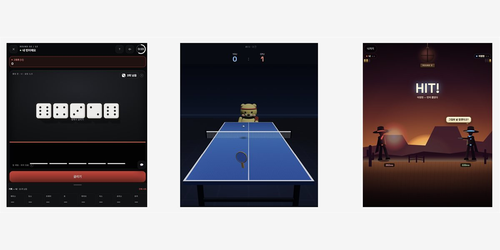
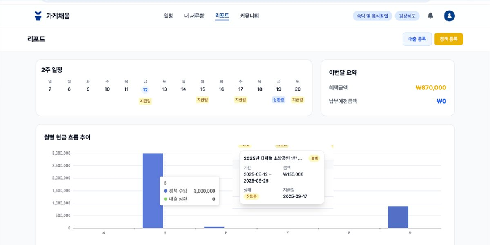
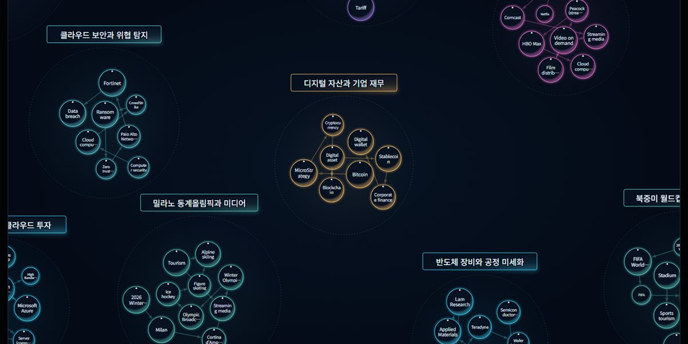
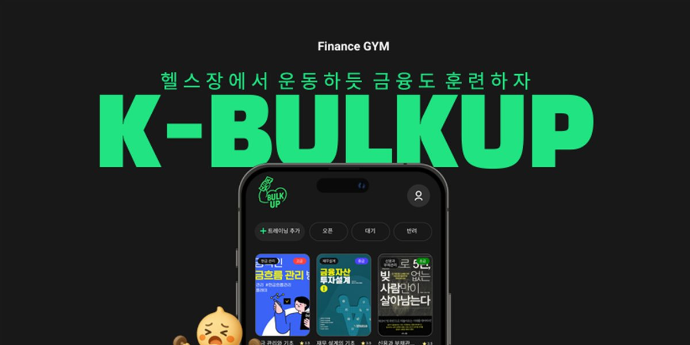
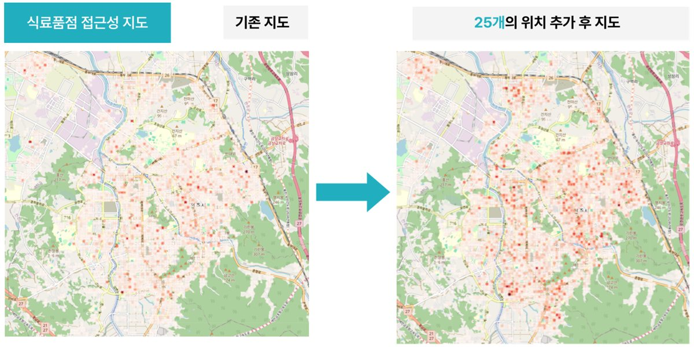

# Sangeun You

산업정보시스템공학 전공

## Tech Stack

    
 
    

## Projects

### 01. YORR

휴대폰을 컨트롤러로 활용하는 실시간 웹 파티게임 · **SSAFY 공통 프로젝트 발표 1위** 
담당: AI 봇, 게임 규칙 API, 탁구 게임 개발

[프로젝트 전체 보기 →](https://github.com/team-yorr/yorr)

---

### 02. 가게채움

소상공인을 위한 대출·정책 지원 통합 플랫폼 · **KB IT's Your Life 해커톤 장려상** 
담당: 정책·대출 추천, 신청 서류, 현금 흐름 리포트 백엔드 API

[프로젝트 전체 보기 →](https://github.com/Gagechaeum)

---

### 03. WikiPulse

위키백과 편집·조회수 급증으로 이슈를 탐지하고 관련 미국 상장 종목을 보여주는 서비스 
담당: 데이터 파이프라인 (과거 데이터 적재, 판정 결과 저장, 이슈 클러스터링)

[프로젝트 전체 보기 →](https://github.com/team-926/WikiPulse)

---

### 04. K-Bulkup

금융 트레이너와 회원을 연결하는 금융 교육 웹 플랫폼 
담당: 트레이닝 등록 화면·API, 리뷰·검색 API, UI 개선

[프로젝트 전체 보기 →](https://github.com/K-Bulkup)

---

### 05. 온마을

식품 사막 지역을 위한 이동식 식료품 판매 서비스 기획 · **전북 공공데이터 활용 창업경진대회 우수상** 
담당: 공공데이터 접근성 분석(2SFCA), 입지 선정(MCLP), 이동 경로 설계 
분석 모델 기준 식료품 접근성 31.89% 개선 (실제 운영 결과 아님 · 공개 소스코드 없음)

## Education & Training

- **SSAFY 15기** — 2026.01 ~ 현재, 1학기 925시간 이수 (교육 중)
- **KB IT's Your Life 6기** — 2025.03 ~ 2025.08, 960시간 수료

## Certifications

정보처리기사 · SQLD · 빅데이터분석기사

## Contact

프로젝트 이미지는 각 팀의 공개 저장소와 발표 자료에서 가져왔습니다.
